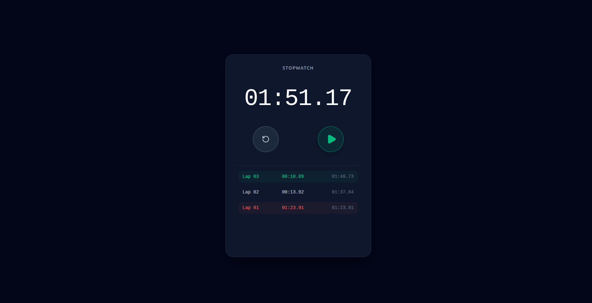

# SCT - Precision Stopwatch Web Application

[](https://sct-wd-2-gamma.vercel.app/)
[](https://reactjs.org/)
[](https://tailwindcss.com/)
[](https://vitejs.dev/)

A highly accurate, stopwatch application featuring lap tracking, persistent storage, and an elegant dark UI. Built to mimic the reliability on the web.

**[View Live Demo (Click Me)](https://sct-wd-2-inky-gamma.vercel.app/)**

## Preview



---

## Key Features

- **Persistent State (`localStorage`)**: The stopwatch utilizes browser local storage and timestamp math. If you start the timer, close the browser tab, and come back hours later, the timer will have kept running accurately in the background.
- **High Precision Timing**: Instead of relying solely on `setInterval` (which is prone to drifting due to JavaScript's single thread and browser tab throttling), time is calculated using `Date.now()` deltas for perfect accuracy.
- **Advanced Lap Tracking**:
  - Records individual lap durations and total elapsed time.
  - **Intelligent Highlighting**: Automatically scans lap history to highlight the **Fastest Lap (Green)** and **Slowest Lap (Red)**, mimicking native mobile OS behavior.
- **Modern Dark UI**: A sleek, distraction-free interface built with Tailwind CSS v4, featuring accessible circular buttons and tabular-numeral fonts to prevent UI jitter when numbers change.
- **Clean Architecture**: State management and core timing logic are cleanly separated from the UI using a custom React Hook (`useStopwatch`).

## Tech Stack

- **Frontend Framework**: React.js
- **Build Tool**: Vite
- **Styling**: Tailwind CSS v4
- **Icons**: Lucide React
- **Utility Libraries**: `clsx`, `tailwind-merge`

## Project Structure

```text
src/
├── components/
│   └── Stopwatch.jsx       # Main UI rendering and lap layout
├── hooks/
│   └── useStopwatch.js     # Core timing logic & localStorage sync
├── utils/
│   ├── cn.js               # Tailwind class merger
│   └── formatTime.js       # Converts raw milliseconds to MM:SS.ms format
├── index.css               # Global Tailwind v4 base styles
└── main.jsx                # React Entry Point
```

## Local Installation & Setup

Want to run this project locally? Follow these steps:

1. **Clone the repository**
   ```bash
   git clone https://github.com/mihir-ax/SCT_WD_2.git
   cd SCT_WD_2
   ```

2. **Install dependencies**
   ```bash
   npm install
   ```

3. **Run the development server**
   ```bash
   npm run dev
   ```

4. **Open your browser**
   Navigate to `http://localhost:5173` to see the application running.
